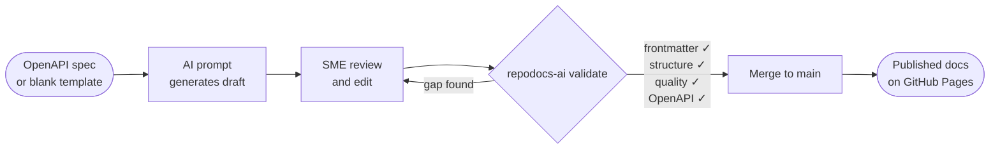

# RepoDocs AI

[](https://github.com/SulagnaSasmal/repodocs-ai/actions/workflows/validate.yml)
[](LICENSE)
[](CHANGELOG.md)

AI-prompt-powered docs-as-code documentation system for SaaS API teams.

RepoDocs AI gives engineering teams a reusable template library, structured AI prompts, diagram starters, and review guardrails for Markdown-based documentation in GitHub repositories.

**[See it live →](https://sulagnasasmal.github.io/repodocs-ai/)**

## Problem

Most SaaS teams still document APIs with inconsistent structure, slow manual writing, and low-trust AI drafts that drift away from the source contract.

## Solution

RepoDocs AI gives engineering teams one repo-native documentation system that combines:

- reusable templates for API, feature, governance, operations, product, and architecture docs
- structured AI prompts for drafting and review
- examples that show the final output shape
- an OpenAPI-to-Markdown generator that drafts endpoint docs from your spec
- validation that checks your docs against the frontmatter schema and your OpenAPI spec, locally and in CI
- an experimental hosted control plane for running automation over HTTP

## Example

If you want to understand RepoDocs AI in under 2 minutes, start with the payments example.

`examples/payments-api/` shows a complete Stripe-style API documentation set for a payments platform built from the shipped templates and API-generation prompt.

It includes:

- `api-overview.md`
- `authentication.md`
- `create-payment.md`
- `error-handling.md`
- `idempotency.md`
- `list-payments.md`
- `retrieve-payment.md`
- `refund-payment.md`
- `webhooks.md`
- `payments-openapi.yaml`

This is the fastest trust check for the product: it shows what a real documentation system built with RepoDocs AI looks like.

To see every step run once, use `npm run proof:path` after install. It bootstraps a sample docs repo, generates docs from the bundled payments spec, validates them, and exports them. The generated docs and exports are written inside this repository, under `generated/` and `exports/`.

Here is what a single endpoint document looks like when built from the template:

```markdown
# Endpoint: Create Payment

## Summary
Create a payment for a customer checkout session.

## Endpoint
- Method: `POST`
- URL: `/payments`

## Authentication Requirements
Bearer authentication is required. See `authentication.md` for token handling and scope guidance.

## Request Body
| Field            | Type   | Required | Description                        |
| ---------------- | ------ | -------- | ---------------------------------- |
| amount           | number | yes      | Payment amount in major currency units |
| currency         | string | yes      | ISO 4217 currency code             |
| customer_id      | string | yes      | Unique customer identifier         |
| payment_method_id| string | no       | Saved payment method identifier    |

## Request Example
curl -X POST "https://api.example.com/v1/payments" \
  -H "Authorization: Bearer <token>" \
  -H "Content-Type: application/json" \
  -d '{"amount":125.5,"currency":"USD","customer_id":"cus_123"}'

## Response Example
{ "payment_id": "pay_123", "status": "pending", "amount": 125.5, "currency": "USD" }

## Error Codes
| Code | Description               |
| ---- | ------------------------- |
| 400  | Invalid payment request   |
| 401  | Unauthorized              |
| 409  | Duplicate payment submission |
```

The full output is in [`examples/payments-api/create-payment.md`](examples/payments-api/create-payment.md).

## How It Works



## Validation in Practice

Running `npm run validate` checks this repository itself and prints one line per check, naming what it looked at (file counts change as the repository grows):

```text
Validated frontmatter for 39 Markdown files in templates, examples.
Validated 98 required project files.
Structure checks passed for 29 Markdown files in examples, generated (placeholders, leftover template text, required sections, examples, suspicious status codes, SME labels, placeholder example values, owners, unsafe HTML, broken Markdown). Accuracy against the OpenAPI spec is checked separately.
Compared 12 endpoint docs in examples/api-docs, examples/payments-api, examples/complete-system, generated against the OpenAPI spec (13 Markdown files describe no endpoint and were not compared).
Checked api_version for 24 Markdown files in examples/api-docs, examples/payments-api, examples/complete-system, generated. 3 of them use api_version 'n/a', which is allowed only for docs that describe no endpoint and is not compared with a spec version.
```

To check your own docs, use `repodocs-ai validate` instead (see [Validate Your Docs](#validate-your-docs)). Inside a clone, `node bin/repodocs.mjs <command>` runs the same CLI.

The final step, `lint:markdown`, prints nothing when there are no linting errors.

Running `npm test`:

```text
 Test Files  13 passed (13)
      Tests  508 passed (508)
```

The tests include the full adopter path (`init`, `generate`, `validate`, and the CI step `init` writes), and the CLI installed from a packed tarball. They run against eleven OpenAPI specs written by other people in `tests/fixtures/third-party/`. They check the generated docs against each spec, not only that the commands succeed. Before each release, a fresh AI agent also follows the README from scratch; the procedure and past reports are in `.github/release-checks/`.

## Quick Start

Install the `repodocs-ai` command, set up a docs repository, generate docs from your OpenAPI spec, and validate them.

> Requires Node.js 20 or later. Check with `node --version`.

```bash
npm install -g github:SulagnaSasmal/repodocs-ai#v1.2.7
repodocs-ai init company-docs
```

Or run any command once without installing, with `npx --yes github:SulagnaSasmal/repodocs-ai#v1.2.7 <command>`. Paths resolve from the folder you run the command in. Run `repodocs-ai help` for every command.

`init` copies the templates, prompts, diagrams, schema and review checklists, and writes a CI workflow, a CODEOWNERS file to fill in, and a starter README. It does not run `git init` or create the GitHub repository for you. Add `--with-examples` to include the payments example set.

### Generate Docs From Your OpenAPI Spec

Put your OpenAPI 3.x file in the docs repository, then generate:

```bash
repodocs-ai generate company-docs/openapi/my-api.yaml company-docs/generated --owner payments-eng
```

`--owner` sets the `owner` field in the frontmatter; without it the owner is `unassigned`, which the quality check flags. `init` creates empty `openapi/`, `generated/` and `docs/` folders for this layout.

No spec yet? Run `repodocs-ai init company-docs --with-examples` and use `company-docs/examples/payments-api/payments-openapi.yaml`.

The output folder contains:

- `api-overview.md`: service overview with authentication, base URL, and versioning
- `endpoints/`: one Markdown file per endpoint, as a draft for SME review

Each endpoint doc covers path, query, header and cookie parameters; JSON, form-encoded and multipart bodies (and any other content type the body accepts); the response example, with its status, response headers such as `Link`, and a text block plus an `Accept` header for CSV or other non-JSON responses; error codes; callbacks; and deprecation. Two routes that would share a file name (`/a-b` and `/a/b`) get separate files. The generated docs pass `validate` and the markdownlint step of the CI workflow as written; the adopter tests check this for all eleven specs.

The generator documents only what the spec says. If the spec leaves something out, such as a required header, the generated docs leave it out too. Where the spec has no description, the doc says `Needs SME input`; where it has no example, the example uses the placeholder `"value"`. The quality check flags both. Review the spec as well as the output.

### Validate Your Docs

Run every content check against your docs, and compare them with your specs:

```bash
repodocs-ai validate company-docs/generated --specs company-docs/openapi
```

The command exits with a non-zero code when a check fails, so it can gate CI.

Each check reports PASS, WARN, FAIL or SKIP and names the folder it checked:

- **Frontmatter:** required fields, which must not be empty, allowed values, a `last_reviewed` date that exists on the calendar and is not in the future, an `owner` written as a lowercase slug (such as `payments-eng`), and a `reviewed_by` approver on any doc whose `status` is `stable` or `beta`, from `schema/metadata-frontmatter.md`.
- **Structure and quality:** errors for leftover placeholders (`TODO`, `FIXME`, `todo:`, `[PLACEHOLDER]`, lorem ipsum, and in prose outside code `TBD` or `T.B.D.` in any case, "to be determined", "description goes here", "fill me in", `?? … ??`, a line that says only "Coming soon", `<insert …>`, `<your-…>` and `{{…}}`), template instructions, HTML that would run script, load content or redirect on a docs site (`<script>`, even split as `<scr<script>ipt>`, `<iframe>`, `<object>`, `<embed>`, `<applet>`, `<portal>`, `<frame>`, `<form>`, `<style>`, `<meta http-equiv>`, inline event handlers, `style` attributes that load a URL, and `javascript:`, `vbscript:` or `data:` links in any form and any attribute, including `formaction`, `srcset`, autolinks, reference-style, entity-encoded and whitespace-split), HTML or a script URL in the frontmatter, a block element such as `<div>` left open, and Markdown that renders differently from how it reads (an unclosed code fence or HTML comment, a table row or separator with the wrong number of cells, a table with no separator row, a heading with no space after `#` or indented into a code block, a second H1). Warnings: missing sections other than the Response section an endpoint doc needs, pages with no `#` title or no `##` headings, images loaded from another site (as `` or Markdown), sections dropped from the template a hand-written doc follows, suspicious status codes in hand-written docs (such as a POST returning 200), unresolved `Needs SME input` labels, placeholder example values, `{name}` or `<name>` placeholders left in the request URL, and owners that are `unassigned`, missing from `schema/owners-registry.md`, or not checked because there is no registry.
- **OpenAPI examples:** request, response and error JSON examples at every depth, in every JSON block and fence of the section: unknown fields, values outside an enum, values of the wrong JSON type, `null` where the spec does not allow it, values outside the spec's minimum, maximum, length, pattern or format (`email`, `uuid`, `uri`, `ipv4`, and `date` and `date-time` as RFC 3339: real calendar days, seconds and a time-zone offset), required request fields left out at any depth, every shape of a `oneOf`, readOnly fields sent in requests and writeOnly fields shown in responses, at any depth and inside any `oneOf` option. The generator and this check share one set of rules, so a generated example never fails it. Request Body table rows: each field exists, with the spec's type (all the types of an `anyOf` or `oneOf`), Required flag, allowed values, default, format, minimum and maximum, a Deprecated note where the spec deprecates it, and whether the body itself is required. Every required nested field of a documented parent has its row; length notes match the spec. Parameter tables, with the same notes, including one row per key of a deepObject parameter and cookie parameters; a warning when a row with an enum does not list its allowed values. In the request example (found even after a comment line or a shell prompt (`$`)): the HTTP method, in upper case, the server URL, the path, its placeholders and its parameter values, query parameters with their types, ranges and allowed values (deepObject keys included; `curl -G` data counts as query), the headers it sends and their values (none the spec does not define, every required one present), cookies and their values, the `Content-Type` of a body (and no body where the operation takes none), the body's top-level type, form-encoded and multipart fields with their types and allowed values, with an error for a real local file path such as `@/etc/passwd`, and credentials for one of the operation's security requirements in the form the spec describes, with the right word in `Authorization` and no empty value. Every curl in the Request Example must call this operation; curls elsewhere in the doc must call a path and method the spec defines. The authentication section, including any header it names and the OAuth scopes it lists, against the spec's security. The Endpoint URL's placeholders against the spec's path parameter names. A doc with two Endpoint, Request Example, Response Example, Request Body or Error Codes sections, or with one of them under another name (`## Example Request`, `## Errors`), which would switch the comparison off. In guides and overview pages, every curl call to a spec server, or to `$BASE_URL`, must use a path and method the spec defines, with valid query parameters, credentials and JSON body; a `wget`, `fetch`, Python `requests` or inline-code call must use a defined path (and method, where the code says it). The overview's base URL and every other server it names must be in the spec. The success status (a 2xx, not an error), a body only where the response has one, JSON only where it is JSON, and Error Codes against the spec's responses, with no success code among them. Two docs in one folder for the same operation are an error. Warnings, which a hand-written doc may leave on purpose: optional parameters and error codes it leaves out, required response fields a response example leaves out, a table header that does not read Name, Type, Required, Description, spec operations with no doc, a Response Example with no `Status:` line, a Request Example with no curl, a missing Summary, Request Example, Response Example or Error Codes section or overview Base URL, an auth header the spec uses on other operations but not this one, an endpoint named in prose (`GET /payment/{id}`) that the spec does not have, and a Swagger 2.0 file in the specs folder, which is not checked.
- **API versions:** `api_version` in frontmatter against the spec's version.

Without `--specs`, the last two checks report SKIP. They also report SKIP when the folder has no endpoint docs to compare. A skipped check did not run; it never counts as a pass, and the summary gives the reason for each one. Add `--strict` to make a skipped check fail the run. Pass several folders to check them together, for example `company-docs/generated company-docs/docs`.

`init` also writes `.github/workflows/docs-validate.yml` into your docs repository. Once you push to GitHub, it runs the same checks on every pull request and every push to `main`, against `generated/` and `docs/`, using the specs in `openapi/`. It uses the same RepoDocs AI version that created the repository, and it fails until there is at least one Markdown doc to check. It also lints the Markdown with `markdownlint-cli`, using the `.markdownlint.json` that `init` writes. Its token is read-only and its actions are pinned to commit SHAs. To pin RepoDocs AI itself to an exact commit rather than a release tag, replace the `#v` version in its `npx` line with the commit SHA.

These checks cover format and consistency with the spec. They cannot tell whether the spec itself is right or complete.

Then open `prompts/review/documentation-review.md` with an AI tool to review each generated doc against the source spec before merging.

### Manual Documentation

For hand-authored docs:

1. Start from a template: `templates/api/` for API docs, `templates/features/` for feature docs, or `templates/governance/` for review guardrails.
2. Add the required frontmatter from `schema/metadata-frontmatter.md`.
3. Use a matching prompt from `prompts/` to draft and review content with an AI assistant.
4. Check the result against the checklists in `validation/`.
5. Commit the docs and review them through pull requests.

## What It Does Not Do

- It does not check whether your spec is correct or complete. Generated docs are only as accurate as the spec.
- It does not copy HTML from the spec into your docs as HTML. Formatting tags (`<p>`, `<b>`, `<i>`, `<code>`, `<a href="https://…">`, lists) become Markdown; any other tag is escaped outside code, so it shows as text, and `javascript:` links are removed. Write HTML by hand where you need it.
- It does not write descriptions the spec lacks. Those sections say `Needs SME input` until someone fills them in.
- It does not document response fields as a table. Response examples, error codes and an example error body are generated; field-level response docs are written by hand.
- When the spec's own example contradicts its schema, the generated doc does not copy the contradiction silently. Fields the schema does not define and readOnly fields in requests are left out, a value of the wrong type is converted when that is exact (`"12"` to `12`), a value that breaks the schema (wrong type, too long, outside an enum or pattern, `null`) is replaced with one that fits, and a missing required field is added; the doc lists each change for an SME to confirm.
- A recursive schema (a tree, a linked list) is documented one level into itself, and examples stop ten levels deep; the checks stop at the same depth.
- Guides are checked against the operation each curl calls, but only what the curl sends: optional parameters it leaves out are fine, and prose about an endpoint is matched only by its method and path.
- The template-section check applies only to a hand-written doc that already follows at least half of one template's sections. Other docs with the same `component` are treated as a different kind of page.
- It cannot tell whether prose is true. If someone replaces `Needs SME input` with an invented sentence, such as a made-up rate limit, or writes a summary that describes the wrong operation, the checks pass.
- It does not flag `XXX` as a placeholder: real specs use it as an ISO currency code and in format masks such as `XXX XXX XXX`.
- It reads OpenAPI 3.0 and 3.1 only. A Swagger 2.0 file is reported and skipped; convert it first.
- An auth header named in a doc that the spec mentions only in its description, or on other operations, is a warning, not an error: many specs describe their API key in prose and declare it on some operations only.
- The Required column accepts `yes`, `required`, `true` and `mandatory`, and `no`, `optional` and `false`. Anything else is an error.
- `component` in frontmatter is free text ("specific module or subsystem"), so any value is accepted.
- In a request example, any `Authorization` value with the prefix the spec describes (such as `Bearer`) passes; the check cannot tell a real key from another token with the same prefix.
- It does not upload anything. `npm run export` writes files formatted for Confluence, Google Docs, Notion and print, which you import yourself.
- It is not published to the npm registry yet. Install it from GitHub, as shown in the Quick Start.
- The hosted control plane, deployment manifests and site starters are experimental and not covered by the adopter tests.

## Evaluate RepoDocs AI

To adopt it into your own docs repository, use the [Quick Start](#quick-start). To evaluate or work on the product itself, clone it:

1. Clone the repository.
2. Run `npm install`. Running the tests needs Node.js 22 or later.
3. Run `npm run validate` to verify the template packs, prompts, examples, and docs structure.
4. Run `npm run proof:path` to run bootstrap, generation, validation and export once on the bundled example.
5. Open `docs/index.md` for the source documentation hub, or the [published site](https://sulagnasasmal.github.io/repodocs-ai/) for the product walkthrough.

Further reading for evaluators:

- `docs/installation.md` for the full install path
- `docs/product-guide.md` for product positioning and fit
- `docs/testing-strategy.md` for a practical app-testing stack to pair with RepoDocs AI
- `docs/index.md` for the source docs hub

## Scope

Version 1 focuses on:

- API documentation
- feature documentation
- documentation governance
- Markdown-first repository workflows

## Live AI Review

If you want to exercise the optional live AI review path rather than prompt-only generation, install dependencies, set an Anthropic API key, and run the documentation agent:

```bash
npm install
export ANTHROPIC_API_KEY=<your-key>
npm run agent:run
```

On Windows PowerShell:

```powershell
npm install
$env:ANTHROPIC_API_KEY = '<your-key>'
npm run agent:run
```

Without `ANTHROPIC_API_KEY`, the agent still runs generation and validation, but records that live AI review was skipped.

For the optional hosted automation runtime:

1. Set `REPODOCS_CONTROL_PLANE_BOOTSTRAP_KEY` and `REDIS_PASSWORD` to random values (`openssl rand -hex 24`). The control plane refuses keys shorter than 24 characters and placeholders such as `replace-me`.
2. Run `npm run control-plane:stack:smoke`.
3. Confirm the Redis-backed control plane and admin flow pass the smoke test.
4. Treat the hosted control plane as experimental: an evaluation and internal automation surface, not an enterprise platform. Enterprise features such as external identity, tenancy isolation, audit logging, and broader operational controls are still roadmap items.

## Repository Layout

```text
repodocs-ai/
├── README.md
├── LICENSE
├── CHANGELOG.md
├── CONTRIBUTING.md
├── CODE_OF_CONDUCT.md
├── .github/
├── docs/
│   ├── index.md
│   ├── installation.md
│   └── product-guide.md
├── diagrams/
├── examples/
├── prompts/
├── templates/
│   ├── api/
│   ├── features/
│   └── governance/
├── scripts/
├── website/        # published site (Docusaurus)
└── experimental/   # control plane deployment, site starters, other CI platforms
```

Product-facing entry points inside `docs/`:

- `docs/index.md`
- `docs/product-guide.md`
- `docs/installation.md`
- `docs/developer-experience-scorecard.md`
- `docs/ready-to-install-system.md`
- `docs/product-specification.md`

Trust and contribution files at the repository root:

- `CHANGELOG.md`
- `CONTRIBUTING.md`
- `CODE_OF_CONDUCT.md`

## Core Principles

1. Templates are modular and reusable.
2. Every template includes AI-ready generation or review guidance.
3. Documentation is designed for repository workflows, not isolated files.
4. Review quality is enforced through structured validation.

## Template Packs

### API

- API overview
- endpoint template

### Product

- product overview
- feature documentation
- user guide
- administrator guide

### Features

- feature overview
- user workflow documentation

### Governance

- review checklist
- quality validation guidance

### Operations

- runbook
- deployment guide

### Architecture

- system architecture
- integration architecture

## Automation

Core, covered by the adopter tests:

- `npm run validate:docs`: frontmatter, structure and quality, OpenAPI example and API version checks for your docs
- OpenAPI-to-Markdown generation, following `$ref` and `allOf`
- a CI workflow written into every bootstrapped docs repository
- validation of this repository itself (`npm run validate`) and Markdown linting
- pull request validation and GitHub Pages workflows for this repository

Available, with lighter testing:

- automatic regeneration workflow for changed OpenAPI specs
- documentation-agent orchestration, with optional live AI review through the Anthropic API
- analytics reports for coverage and freshness, and a knowledge graph built from frontmatter and endpoints
- export to files formatted for Confluence (storage-format HTML), Google Docs (HTML), Notion (Markdown) and print (HTML and a plain-text PDF)

Experimental:

- a small hosted control plane with per-user API keys and a Redis-backed job queue
- container packaging and deployment manifests for Render, Fly.io and Azure Container Apps
- MkDocs, Docusaurus, GitBook and Next.js starter integrations

## Product Surface

If you want the repository to feel like a clean developer product, use these entry points first:

- `README.md` for the top-level promise and install path
- `docs/index.md` for the source docs hub
- `templates/README.md` for the template packs
- `prompts/README.md` for AI prompt packs
- `examples/README.md` for working reference systems
- `diagrams/README.md` for visual starters

## Roadmap

See `ROADMAP.md` for planned work.

The repository includes an end-to-end sample under `examples/complete-system/`. Experimental parts, including the MkDocs, Docusaurus, GitBook and Next.js starters, GitLab and Bitbucket CI files, and the control plane deployment files, are listed in `experimental/README.md`.

## UI

The published site at [sulagnasasmal.github.io/repodocs-ai](https://sulagnasasmal.github.io/repodocs-ai/) is built with Docusaurus from `website/`, and its docs pages come from `docs/`. The static pages in `site/` are an older version of the site and are not deployed.

## Automation Commands

- `npm run validate`
- `npm run agent:run`
- `npm run analytics:report`
- `npm run graph:build`
- `npm run automation:run`
- `npm run export`
- `npm run export:notion`

See `docs/roadmap-spec-summary.md` for a direct map between the specification, roadmap, current phase coverage, and remaining gaps.
The published version is at [sulagnasasmal.github.io/repodocs-ai/spec-summary.html](https://sulagnasasmal.github.io/repodocs-ai/spec-summary.html).
See `docs/spec-scorecard.md` for a strict 17-section scorecard against the product specification in `docs/product-specification.md`.

## Feedback Loop

If you are evaluating RepoDocs AI on a real spec or want to help shape the product:

- open a GitHub Discussion
- file the `Docs Generated From My Spec` issue form in GitHub Issues

## Buyer Fit

RepoDocs AI is designed for:

- startup CTOs
- heads of engineering
- developer relations leads
- technical writers in API-first SaaS teams

## Experimental: Hosted Control Plane

The optional, experimental hosted control plane runs automation over HTTP with Redis-backed durable queued execution. It is not required for using the template and prompt system.

### Control Plane Commands

- `npm run control-plane:start`
- `npm run control-plane:smoke`
- `npm run control-plane:stack:up`
- `npm run control-plane:stack:smoke`
- `npm run control-plane:stack:down`
- `npm run docker:control-plane:build`
- `npm run docker:control-plane:run`

### Control Plane Environment

- `REPODOCS_CONTROL_PLANE_HOST`
- `REPODOCS_CONTROL_PLANE_PORT`
- `REDIS_URL`
- `REPODOCS_CONTROL_PLANE_DATA_DIR`
- `REPODOCS_CONTROL_PLANE_BOOTSTRAP_USER`
- `REPODOCS_CONTROL_PLANE_BOOTSTRAP_DISPLAY_NAME`
- `REPODOCS_CONTROL_PLANE_BOOTSTRAP_KEY`
- `REPODOCS_TRUST_PROXY` (set to `1` behind a load balancer or reverse proxy)
- `REPODOCS_RATE_LIMIT_PER_MINUTE` and `REPODOCS_FAILED_AUTH_PER_MINUTE` (defaults 120 and 10)

The control plane stores queue state, run metadata, and user/key records in Redis so multiple app instances can safely accept and process jobs against shared state. The legacy `.control-plane/*.json` files are only used as a one-time migration source when Redis starts empty.

For local development, the repository includes an `experimental/deploy/compose.yaml` stack that runs Redis and the control plane together. Both services publish Docker health checks, so `docker compose ps` shows when Redis is ready and when the control plane is answering `/health`. Set `REPODOCS_CONTROL_PLANE_BOOTSTRAP_KEY` and `REDIS_PASSWORD` in your shell or environment, then run `npm run control-plane:stack:up`. Redis is reachable only from the control plane, and the control plane only from this machine. See `SECURITY.md` for the server's limits and headers.

To run a repeatable end-to-end verification against a live stack, use `npm run control-plane:smoke`. To boot the compose stack and run the smoke test in one step, use `npm run control-plane:stack:smoke`.

### Management Endpoints

- `GET /users` for admin user inventory
- `POST /users` to create a user and initial key
- `PATCH /users/:id` to update role, display name, or status
- `POST /users/:id/keys` to rotate or add a user key
- `DELETE /users/:id/keys/:keyId` to revoke a key

### Hosted Deployment Manifests

- `experimental/deploy/render.yaml`
- `experimental/deploy/fly.toml`
- `experimental/deploy/azure-container-apps.yaml`

Render and Fly.io expect these files at the repository root: copy them there, or point the platform at their path, before deploying.