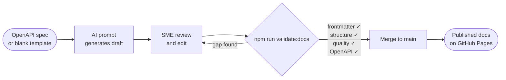

# RepoDocs AI

[](https://github.com/SulagnaSasmal/repodocs-ai/actions/workflows/validate.yml)
[](LICENSE)
[](CHANGELOG.md)

AI-prompt-powered docs-as-code documentation system for SaaS API teams.

RepoDocs AI gives engineering teams a reusable template library, structured AI prompts, diagram starters, and review guardrails for Markdown-based documentation in GitHub repositories.

**[See it live →](https://sulagnasasmal.github.io/repodocs-ai/)**

## Problem

Most SaaS teams still document APIs with inconsistent structure, slow manual writing, and low-trust AI drafts that drift away from the source contract.

## Solution

RepoDocs AI gives engineering teams one repo-native documentation system that combines:

- reusable templates for API, feature, governance, operations, product, and architecture docs
- structured AI prompts for drafting and review
- examples that show the final output shape
- validation scripts for documentation quality and structure
- an optional hosted control plane for automation

## Example

If you want to understand RepoDocs AI in under 2 minutes, start with the payments example.

`examples/payments-api/` shows a complete Stripe-style API documentation set for a payments platform built from the shipped templates and API-generation prompt.

It includes:

- `api-overview.md`
- `authentication.md`
- `create-payment.md`
- `error-handling.md`
- `idempotency.md`
- `list-payments.md`
- `retrieve-payment.md`
- `refund-payment.md`
- `webhooks.md`
- `payments-openapi.yaml`

This is the fastest trust check for the product: it shows what a real documentation system built with RepoDocs AI looks like.

If you want to verify the full adopter flow, run `npm run proof:path` after install. It bootstraps a docs repo, generates API docs, validates the result, and exports artifacts end to end.

Here is what a single endpoint document looks like when built from the template:

```markdown
# Endpoint: Create Payment

## Summary
Create a payment for a customer checkout session.

## Endpoint
- Method: `POST`
- URL: `/payments`

## Authentication Requirements
Bearer authentication is required. See `authentication.md` for token handling and scope guidance.

## Request Body
| Field            | Type   | Required | Description                        |
| ---------------- | ------ | -------- | ---------------------------------- |
| amount           | number | yes      | Payment amount in major currency units |
| currency         | string | yes      | ISO 4217 currency code             |
| customer_id      | string | yes      | Unique customer identifier         |
| payment_method_id| string | no       | Saved payment method identifier    |

## Request Example
curl -X POST "https://api.example.com/v1/payments" \
  -H "Authorization: Bearer <token>" \
  -H "Content-Type: application/json" \
  -d '{"amount":125.5,"currency":"USD","customer_id":"cus_123"}'

## Response Example
{ "payment_id": "pay_123", "status": "pending", "amount": 125.5, "currency": "USD" }

## Error Codes
| Code | Description               |
| ---- | ------------------------- |
| 400  | Invalid payment request   |
| 401  | Unauthorized              |
| 409  | Duplicate payment submission |
```

The full output is in [`examples/payments-api/create-payment.md`](examples/payments-api/create-payment.md).

## How It Works



## Validation in Practice

Running `npm run validate` checks this repository itself and prints one line per check, naming what it looked at (file counts change as the repository grows):

```text
Validated frontmatter for 39 Markdown files in templates, examples.
Validated 108 required project files.
Structure checks passed for 24 Markdown files in examples, generated (placeholders, required sections, examples, status codes, SME labels). Accuracy against the OpenAPI spec is checked separately.
Compared 2 endpoint docs in examples/api-docs, generated against the OpenAPI spec (1 Markdown file describes no endpoint and was not compared).
Checked api_version for 10 Markdown files in examples/api-docs, examples/complete-system, generated.
```

To check your own docs, use `npm run validate:docs` instead (see [Validate Your Docs](#validate-your-docs)).

The final step, `lint:markdown`, prints nothing when there are no linting errors.

Running `npm test`:

```text
 ✓ tests/agent-workflow.test.mjs (30 tests)
 ✓ tests/validate-structure.test.mjs (81 tests)
 ✓ tests/validate-frontmatter.test.mjs (18 tests)
 ✓ tests/prompt-library.test.mjs (31 tests)
 ✓ tests/example-docs.test.mjs (25 tests)
 ✓ tests/generate-openapi-docs.test.mjs (13 tests)
 ✓ tests/validate-docs.test.mjs (8 tests)

 Test Files  7 passed (7)
      Tests  206 passed (206)
```

## Quick Start

This is the fastest way to use RepoDocs AI as a developer adopting it into a real documentation repository.

1. Clone RepoDocs AI.
1. Copy the starter assets into your new docs repository.
1. Start documenting APIs.

On bash:

```bash
git clone https://github.com/SulagnaSasmal/repodocs-ai.git
mkdir company-docs
cp -R repodocs-ai/templates company-docs/
cp -R repodocs-ai/prompts company-docs/
cp -R repodocs-ai/diagrams company-docs/
```

On Windows PowerShell:

```powershell
git clone https://github.com/SulagnaSasmal/repodocs-ai.git
New-Item -ItemType Directory -Name company-docs
Copy-Item repodocs-ai\templates -Destination company-docs\ -Recurse
Copy-Item repodocs-ai\prompts -Destination company-docs\ -Recurse
Copy-Item repodocs-ai\diagrams -Destination company-docs\ -Recurse
```

Or use the one-command bootstrap from inside the cloned repo:

> Requires Node.js 20 or later. Check with `node --version` before running.

```bash
git clone https://github.com/SulagnaSasmal/repodocs-ai.git
cd repodocs-ai
npm install
npm run bootstrap:docs-repo -- ../company-docs
```

To include the payments example set as a starting reference, add `--with-examples`:

```bash
npm run bootstrap:docs-repo -- ../company-docs --with-examples
```

### Generate Docs From Your OpenAPI Spec

The bootstrap does not create a spec for you. Put your OpenAPI 3.x file in your docs repository first, for example at `../company-docs/openapi/my-api.yaml`.

Then run the generator from inside the repodocs-ai clone. Both paths are resolved from the repodocs-ai folder:

```bash
node scripts/generate-openapi-docs.mjs ../company-docs/openapi/my-api.yaml ../company-docs/generated/my-api
```

No spec yet? Try the bundled payments example:

```bash
node scripts/generate-openapi-docs.mjs examples/payments-api/payments-openapi.yaml ../company-docs/generated/payments-api
```

The output folder contains:

- `api-overview.md`: service overview with authentication, base URL, and versioning
- `endpoints/`: one Markdown file per endpoint, structured and ready for SME review

The generator documents only what the spec says. If the spec leaves something out, such as a required header, the generated docs leave it out too. Review the spec as well as the output.

### Validate Your Docs

Run every content check against your docs, and compare them with your specs:

```bash
npm run validate:docs -- ../company-docs/generated --specs ../company-docs/openapi
```

Each check reports PASS, WARN, FAIL or SKIP and names the folder it checked:

- **Frontmatter:** required fields and allowed values, from `schema/metadata-frontmatter.md`.
- **Structure and quality:** leftover placeholders, required sections, examples, suspicious status codes, and unresolved `Needs SME input` labels.
- **OpenAPI examples:** request and response example fields and parameters against the spec.
- **API versions:** `api_version` in frontmatter against the spec's version.

Without `--specs`, the last two checks report SKIP. A skipped check did not run; it never counts as a pass. Pass several folders to check them together, for example `../company-docs/generated ../company-docs/docs`.

The bootstrap also writes `.github/workflows/docs-validate.yml` into your docs repository. Once you push to GitHub, it runs the same checks on every pull request against `generated/` and `docs/`, using the specs in `openapi/`.

These checks cover format and consistency with the spec. They cannot tell whether the spec itself is right or complete.

Then open `prompts/review/documentation-review.md` with an AI tool to review each generated doc against the source spec before merging.

### Manual Documentation

For hand-authored docs:

1. Start from a template: `templates/api/` for API docs, `templates/features/` for feature docs, or `templates/governance/` for review guardrails.
2. Add the required frontmatter from `schema/metadata-frontmatter.md`.
3. Use a matching prompt from `prompts/` to draft and review content with an AI assistant.
4. Check the result against the checklists in `validation/`.
5. Commit the docs and review them through pull requests.

## What This Repo Is

RepoDocs AI is a developer product for teams that want to stand up a serious documentation repository quickly.

It is not just a folder of Markdown templates. It includes:

- reusable templates for API, feature, governance, operations, product, and architecture docs
- prompt packs for AI drafting and review
- examples that show the system in practice
- validation scripts for documentation quality and structure
- an optional hosted control plane for automation

## Evaluate RepoDocs AI

RepoDocs AI is cloned and used directly, not installed from npm. The `"private": true` flag in `package.json` prevents accidental publishing.

To adopt it into your own docs repository, use the [Quick Start](#quick-start). To evaluate the product itself:

1. Clone the repository.
2. Run `npm install`.
3. Run `npm run validate` to verify the template packs, prompts, examples, and docs structure.
4. Run `npm run proof:path` to verify the end-to-end bootstrap, generation, validation, and export path.
5. Open `docs/index.md` for the source documentation hub or `site/index.html` for the product walkthrough.

Further reading for evaluators:

- `docs/installation.md` for the 5-minute install path
- `docs/product-guide.md` for product positioning and fit
- `docs/testing-strategy.md` for a practical app-testing stack to pair with RepoDocs AI
- `docs/public-launch-checklist.md` for the final Pages and launch checks
- `docs/community-feedback-discussion.md` for the pinned feedback discussion copy
- `docs/design-partner-intake.md` for the design-partner intake questions
- `docs/index.md` for the source docs hub
- `site/installation.html` for the published quickstart page

The repository currently implements the Phase 1 and Phase 2 foundation of the product, plus a baseline of Phase 3 automation:

- product specification and scope definition
- metadata and validation system
- product documentation templates
- API documentation templates
- AI prompt packs for generation and review
- example documentation sets
- Phase 3 validation and publishing automation
- OpenAPI-assisted document generation scaffold
- static landing and docs site for product presentation

## Scope

Version 1 focuses on:

- API documentation
- feature documentation
- documentation governance
- Markdown-first repository workflows

## Live AI Review

If you want to exercise the optional live AI review path rather than prompt-only generation, install dependencies, set an Anthropic API key, and run the documentation agent:

```bash
npm install
export ANTHROPIC_API_KEY=<your-key>
npm run agent:run
```

On Windows PowerShell:

```powershell
npm install
$env:ANTHROPIC_API_KEY = '<your-key>'
npm run agent:run
```

Without `ANTHROPIC_API_KEY`, the agent still runs generation and validation, but records that live AI review was skipped.

For the optional hosted automation runtime:

1. Set `REPODOCS_CONTROL_PLANE_BOOTSTRAP_KEY`.
2. Run `npm run control-plane:stack:smoke`.
3. Confirm the Redis-backed control plane and admin flow pass the smoke test.
4. Treat the hosted control plane as an evaluation and internal automation surface, not an enterprise platform. Enterprise features such as external identity, tenancy isolation, audit logging, and broader operational controls are still roadmap items.

## Repository Layout

```text
repodocs-ai/
├── README.md
├── LICENSE
├── CHANGELOG.md
├── CONTRIBUTING.md
├── CODE_OF_CONDUCT.md
├── .github/
├── docs/
│   ├── index.md
│   ├── installation.md
│   └── product-guide.md
├── diagrams/
├── examples/
├── prompts/
├── templates/
│   ├── api/
│   ├── features/
│   └── governance/
├── site/
└── scripts/
```

Product-facing entry points inside `docs/`:

- `docs/index.md`
- `docs/product-guide.md`
- `docs/installation.md`
- `docs/market-validation.md`
- `docs/developer-experience-scorecard.md`
- `docs/ready-to-install-system.md`
- `docs/product-specification.md`

Trust and contribution files at the repository root:

- `CHANGELOG.md`
- `CONTRIBUTING.md`
- `CODE_OF_CONDUCT.md`

## Core Principles

1. Templates are modular and reusable.
2. Every template includes AI-ready generation or review guidance.
3. Documentation is designed for repository workflows, not isolated files.
4. Review quality is enforced through structured validation.

## Template Packs

### API

- API overview
- endpoint template

### Product

- product overview
- feature documentation
- user guide
- administrator guide

### Features

- feature overview
- user workflow documentation

### Governance

- review checklist
- quality validation guidance

### Operations

- runbook
- deployment guide

### Architecture

- system architecture
- integration architecture

## Automation

- frontmatter validation for templates and examples
- repository structure validation
- documentation quality validation for examples and generated output
- schema-aware OpenAPI validation for endpoint examples
- request-body validation against OpenAPI request schemas
- version-compatibility validation for API docs and examples
- deprecation and migration validation for versioned endpoint docs
- Markdown linting
- OpenAPI-to-Markdown generation script
- automatic regeneration workflow for changed OpenAPI specs
- runnable documentation-agent orchestration for OpenAPI sources
- runnable analytics report generation for repository coverage and freshness
- runnable knowledge-graph generation from frontmatter, dependencies, and endpoints
- export pipelines for Confluence, Google Docs, Notion, and PDF-ready artifacts
- small hosted control plane for running automation over HTTP
- per-user API-key and bearer-token authentication for control-plane endpoints
- Redis-backed durable queued execution so multiple automation requests can be accepted safely across restarts and workers
- container packaging for hosted control-plane deployment
- hosted deployment manifest for Render with persistent disk configuration
- hosted deployment manifests for Fly.io and Azure Container Apps
- pull request validation workflow
- GitHub Pages deployment workflow
- MkDocs starter integration
- Docusaurus starter integration
- GitBook starter integration
- Next.js docs starter integration

## Product Surface

If you want the repository to feel like a clean developer product, use these entry points first:

- `README.md` for the top-level promise and install path
- `docs/index.md` for the source docs hub
- `templates/README.md` for the template packs
- `prompts/README.md` for AI prompt packs
- `examples/README.md` for working reference systems
- `diagrams/README.md` for visual starters

## Phase Status

### Phase 1

- product specification stored in `docs/`
- repository structure established
- metadata schema defined
- validation and review guardrails added

### Phase 2

- product documentation template pack added
- API documentation template pack added
- prompt packs added for authoring and review
- example documentation added

### Phase 3

- validation scripts added for frontmatter and repository structure
- OpenAPI generation script and manual workflow added
- schema-aware OpenAPI example validation added
- request-body schema validation added
- automatic regeneration workflow added for changed OpenAPI specs
- GitHub Actions added for pull request checks
- static landing and docs pages added under `site/`
- GitHub Pages deployment workflow added

## Roadmap

See `ROADMAP.md` for planned work.

The repository includes starter packs for both MkDocs and Docusaurus, plus an end-to-end sample under `examples/complete-system/`.

The repository also includes GitBook and Next.js starter packs, GitLab and Bitbucket support assets, pricing and bundle manifests, and runnable repository automation for documentation agents, knowledge graph indexing, and analytics.

## UI

RepoDocs AI includes a lightweight static UI in `site/` for GitHub Pages deployment. It covers the landing page, roadmap, automation summary, and complete-system walkthrough.

## Automation Commands

- `npm run validate`
- `npm run agent:run`
- `npm run analytics:report`
- `npm run graph:build`
- `npm run automation:run`
- `npm run export`
- `npm run export:notion`

See `docs/roadmap-spec-summary.md` for a direct map between the specification, roadmap, current phase coverage, and remaining gaps.
For the published Pages version, open [sulagnasasmal.github.io/repodocs-ai/spec-summary.html](https://sulagnasasmal.github.io/repodocs-ai/spec-summary.html) (live once GitHub Pages is enabled in repository settings).
See `docs/spec-scorecard.md` for a strict 17-section scorecard against the product specification in `docs/product-specification.md`.

## Feedback Loop

If you are evaluating RepoDocs AI on a real spec or want to help shape the product:

- open a GitHub Discussion using `docs/community-feedback-discussion.md`
- file the `Docs Generated From My Spec` issue form in GitHub Issues
- use `docs/design-partner-intake.md` to start design-partner outreach

## Buyer Fit

RepoDocs AI is designed for:

- startup CTOs
- heads of engineering
- developer relations leads
- technical writers in API-first SaaS teams

## Advanced: Hosted Control Plane

The optional hosted control plane enables running automation over HTTP with Redis-backed durable queued execution. It is not required for using the template and prompt system.

### Control Plane Commands

- `npm run control-plane:start`
- `npm run control-plane:smoke`
- `npm run control-plane:stack:up`
- `npm run control-plane:stack:smoke`
- `npm run control-plane:stack:down`
- `npm run docker:control-plane:build`
- `npm run docker:control-plane:run`

### Control Plane Environment

- `REPODOCS_CONTROL_PLANE_HOST`
- `REPODOCS_CONTROL_PLANE_PORT`
- `REDIS_URL`
- `REPODOCS_CONTROL_PLANE_DATA_DIR`
- `REPODOCS_CONTROL_PLANE_BOOTSTRAP_USER`
- `REPODOCS_CONTROL_PLANE_BOOTSTRAP_DISPLAY_NAME`
- `REPODOCS_CONTROL_PLANE_BOOTSTRAP_KEY`

The control plane stores queue state, run metadata, and user/key records in Redis so multiple app instances can safely accept and process jobs against shared state. The legacy `.control-plane/*.json` files are only used as a one-time migration source when Redis starts empty.

For local development, the repository includes a `compose.yaml` stack that runs Redis and the control plane together. Both services publish Docker health checks, so `docker compose ps` shows when Redis is ready and when the control plane is answering `/health`. Set `REPODOCS_CONTROL_PLANE_BOOTSTRAP_KEY` in your shell or environment, then run `npm run control-plane:stack:up`.

To run a repeatable end-to-end verification against a live stack, use `npm run control-plane:smoke`. To boot the compose stack and run the smoke test in one step, use `npm run control-plane:stack:smoke`.

### Management Endpoints

- `GET /users` for admin user inventory
- `POST /users` to create a user and initial key
- `PATCH /users/:id` to update role, display name, or status
- `POST /users/:id/keys` to rotate or add a user key
- `DELETE /users/:id/keys/:keyId` to revoke a key

### Hosted Deployment Manifests

- `render.yaml`
- `fly.toml`
- `azure-container-apps.yaml`